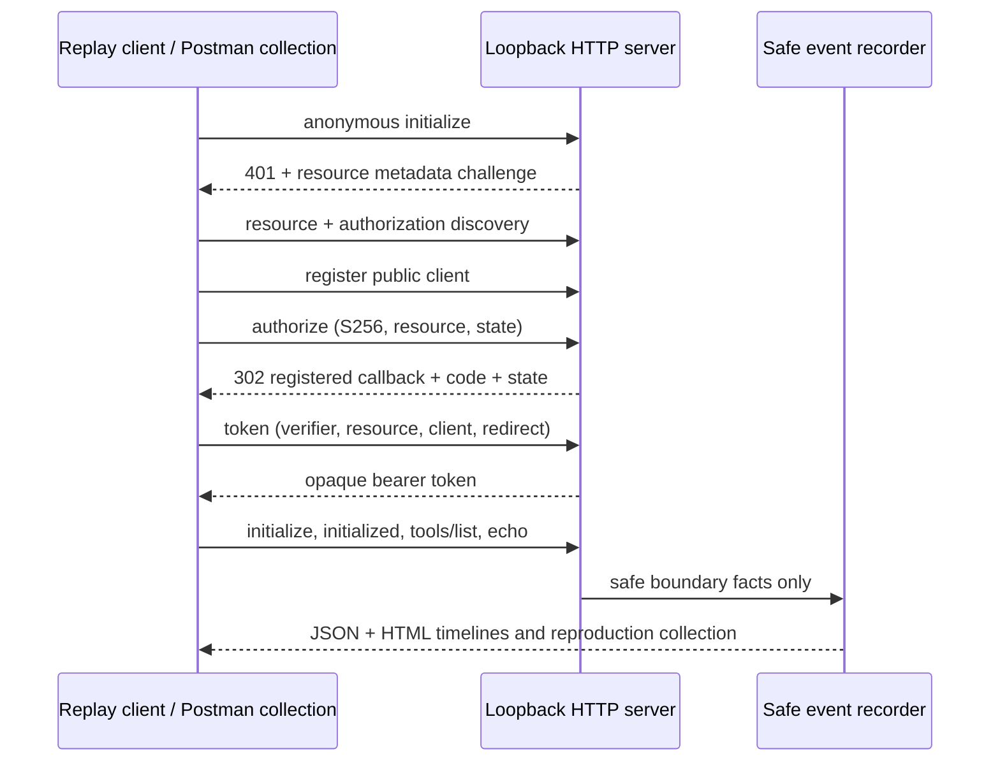

# MCP Auth Flight Recorder

## Problem and constraints
Postman issue [#14119](https://github.com/postmanlabs/postman-app-support/issues/14119) reports a successful OAuth exchange followed by an unauthenticated MCP initialize. It is a user report, not our desktop reproduction. A follow-up also retracts a clean version bisect. We reproduce the reported wire symptom with a synthetic client, not proprietary Postman code.

Build an offline, loopback-only diagnostic target: RFC 9728 resource discovery, RFC 8414 authorization metadata, RFC 7591 public-client registration, S256 PKCE, resource binding, and a protected JSON HTTP MCP echo tool. No LLM or employer code/data. This is deliberately not a production identity provider.

## Three hardest decisions
1. **Record facts, not wire dumps.** An allowlisted event schema records method, static path, status, header presence, token issuance, and a bounded reason. Never retain headers, bodies, query strings, tokens, codes, verifier, state, user text or client IDs in a timeline. Rejected recursive redaction: unknown fields and encoded credentials bypass deny lists. Losing arbitrary payload debugging is an intentional tradeoff.
2. **Separate expected discovery 401 from failure.** The first anonymous probe is a challenge, not a broken connection. Diagnose only the post-exchange initialize (or the earlier failed OAuth boundary), with per-run correlation. Rejected “last 401 means OAuth failed”: it obscures the precise regression. Local server reasons are ground truth only for this fixture, not a universal classifier for remote IdPs.
3. **Real HTTP, synthetic consent.** Exercise sockets, form encoding, redirects, single-use codes, client/redirect binding, expiry, audience, and scopes using the standard library. Authorization auto-approves only registered synthetic clients; no real user login. Rejected real IdP dependency: credentials and network would undermine an offline reproduction. Rejected full production OAuth implementation: out of scope for a small recorder.

## Architecture and data flow

A lock serializes in-memory grant consumption and trace writes. A monotonic clock governs expiry and durations. Server callbacks and advertised URLs use its bound address, never untrusted Host headers. The CLI owns server lifetime and closes it even on failure. HTTP JSON mode is stateless: no session ID or SSE stream. Protocol version is 2025-06-18. Each protected request revalidates the bearer.

## Failure behavior and security
Bad PKCE, replay, client/redirect mismatch and wrong resource fail closed. Missing/invalid/expired bearer yields 401 plus discovery challenge; missing echo scope yields 403. Malformed JSON/forms and oversized requests yield bounded errors. State is generated and checked by the replay client. No proxy or arbitrary external URL fetch. Redirect targets are exactly pre-registered allowlisted callbacks. Loopback HTTP is for local testing only. DNS rebinding is rejected by Host validation; browser Origin is denied. Retention is in-memory until process exit; export is safe facts only. Synthetic consent and public runtime tokens are unsuitable for real data. No refresh-token grant is advertised.

## Acceptance Criteria & Evidence Contract
| ID | Criterion | Proof | Observable assertion |
|---|---|---|---|
| EC-1 | Given valid PKCE, discovery through echo succeeds over real HTTP | Integration | echo returns the synthetic input |
| EC-2 | Given an issued token not attached to initialize, locate the fault | Integration + demo | missing_authorization at POST /mcp, not token exchange |
| EC-3 | Given seeded auth faults, isolate each boundary | Integration + demo | six exact expected diagnoses |
| EC-4 | Given successful or failed handshakes, export no raw credentials | Integration | sentinel tokens/codes/verifier/state absent from JSON/HTML/collection |
| EC-5 | Given replayed codes, wrong verifier/client/redirect/resource or expired token, reject | Integration | 400 or 401, never echo success |
| EC-6 | Given generated collection, replay its HTTP requests offline | Integration | valid echo and deliberate missing-header 401 |

## At 100× scale
This is a bounded local lab, not an ingest service. Cap request bodies and state; restart between desktop investigations. For a multi-user recorder, use tenant-authenticated ingress, per-tenant quotas, durable append-only safe events, expiring grants in a transactional store, and streaming export. Measure ingress and export contention before replacing the lock. Do not persist raw wire traffic. Browser consent and TLS become mandatory outside loopback.

## Rollout and limitations
No migration: new standalone local repository. Start with synthetic cases; import the exported collection next. Native MCP-client verification is a separate manual, version-recorded step. No Postman login or network API needed. No patch to Postman's proprietary app, refresh flow, confidential clients, revocation, SSE, or external IdP support. A public OSS server integration is not necessary for isolating the client header boundary. Nothing is vendored.
