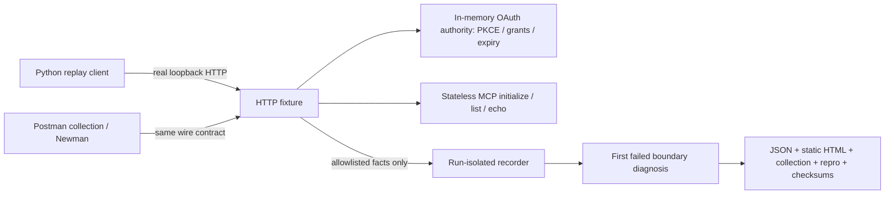

# MCP Auth Flight Recorder

OAuth can succeed while the next MCP request carries no bearer. For engineers debugging that boundary, [Postman issue #14119](https://github.com/postmanlabs/postman-app-support/issues/14119) provides a concrete user report: token exchange returns 200, then initialize gets 401. This project reproduces **that wire symptom with a synthetic client**, not a verified Postman desktop regression or a proprietary app patch.

```sh
make demo
```

Python 3.11+; no runtime dependencies, account, API key, LLM, or external service. The command starts loopback servers, runs seven real HTTP handshakes, exports a shareable bundle, and closes every server.

**6/6 seeded auth faults localized to the expected protocol boundary.** Captured output from a local run (timings vary):

```text
MCP Auth Flight Recorder | synthetic local HTTP; Postman desktop not tested
valid                pass                     echo returned synthetic hello
missing_bearer       missing_authorization    POST /mcp
invalid_bearer       invalid_token            POST /mcp
expired_token        expired_token            POST /mcp
insufficient_scope   insufficient_scope       POST /mcp
pkce_mismatch        pkce_mismatch            POST /oauth/token
resource_mismatch    resource_mismatch        POST /oauth/token
Fault localization: 6/6
Raw credentials in exported artifacts: 0
Max failed-response-to-diagnosis: 0.022 ms (local classification, not human debugging time)
Bundle: artifacts/ [report.json, timeline.html, postman.collection.json, repro.json, checksums.json]
```

Open `artifacts/timeline.html`. The valid and missing-bearer timelines match through token issuance; the next `POST /mcp` diverges. The expected anonymous discovery 401 is not misreported as a failed login. [Captured sample bundle](examples/report.json) and [HTML timeline](examples/timeline.html) are committed; download the HTML to view it locally.

## What's hard here

- **OAuth success is not transport success.** Discover the resource and issuer, bind code exchange to the client, redirect, S256 verifier and resource, then check authorization on every MCP request.
- **A useful trace must not become a credential dump.** Record allowlisted facts, not redacted copies of bodies or headers. Tokens, codes, verifier, state, client IDs and echoed user text never enter timeline events. Export scans also check all generated run credentials before writing.
- **Failure localization needs context.** Ignore the initial challenge, retain the first real failed boundary, isolate runs, distinguish 401 from insufficient-scope 403, and make concurrent code redemption atomic.

## Architecture



The implementation follows the public [MCP 2025-06-18 authorization specification](https://modelcontextprotocol.io/specification/2025-06-18/basic/authorization): RFC 9728 protected-resource discovery, RFC 8414 authorization discovery, RFC 7591 public-client registration, RFC 7636 S256, and RFC 8707 resource indicators. It implements the small subset needed for this experiment, not general OAuth or MCP certification.

| Seed | Expected boundary | Observed server fact |
|---|---|---|
| Missing bearer after issuance | `POST /mcp` | 401; header absent |
| Random invalid bearer | `POST /mcp` | 401; token unknown |
| Expired bearer | `POST /mcp` | 401; deadline elapsed |
| Token lacking echo scope | `POST /mcp` | 403; insufficient scope |
| Wrong PKCE verifier | `POST /oauth/token` | 400; verifier mismatch |
| Changed resource at exchange | `POST /oauth/token` | 400; resource mismatch |

Expiry uses an injected monotonic clock advanced by 61 seconds, not a real minute of sleeping. Protocol traffic is real. Consent auto-approves synthetic clients. There is no AI decision maker or mocked network response.

## Run and verify

```sh
# Demo needs only the Python standard library.
make demo
python3 -m flight_recorder demo --case missing_bearer --out artifacts/issue-14119

# Full development checks require Python 3.11+, Node 20+, npm and make.
# Setup downloads pinned development dependencies; subsequent checks run offline.
make setup
make check
```

The 62 pytest cases cover real HTTP, grant binding and replay, expiry, scopes, malformed inputs, code-redemption concurrency, exact fault localization, credential absence, HTML escaping, CLI shutdown, and the exported collection executing through Postman's public [Newman 6.2.3](https://github.com/postmanlabs/newman) runner. The runner executes scripts and assertions; this is not a hand-written approximation of a collection runner. Python's standard library serves the demo; Newman is a development-only dependency. Its lockfile retains upstream legacy/deprecation warnings; it is not a production dependency of the fixture.

CI configuration runs checks and the demo on Python 3.11/3.13 with Node 22. Local verification is recorded in [EVIDENCE.md](EVIDENCE.md); no hosted CI run is claimed.

### Exercise the collection yourself

```sh
python3 -m flight_recorder serve --port 8765
# In another terminal, after make setup:
node node_modules/newman/bin/newman.js run artifacts/desktop/postman.collection.json
```

Or import that collection into Postman's HTTP Collection Runner. Its sequence discovers, registers, exchanges, initializes, lists tools, echoes, deliberately omits the bearer once, and fetches the safe timeline. Runtime credentials use local `pm.variables`, not saved collection or environment values. Do not share raw runner console, network logs or JSON/HTML runner reports: they can contain runtime OAuth material. Share only this recorder's allowlisted bundle. Restart the fixture between independent investigations or change the collection's `run_id`.

The collection proves HTTP contracts and the missing-header fixture. **It does not drive Postman's native MCP OAuth UI.**

### Native MCP-client investigation (manual; not exercised here)

1. Run `serve`, then create an HTTP MCP connection to `http://127.0.0.1:8765/mcp` in Postman. Use the numeric loopback address, not `localhost`.
2. Discovery advertises registration and authorization endpoints. Register a public client with redirect `https://oauth.pstmn.io/v1/callback`, then use its returned client ID if the UI requires manual OAuth configuration. Use auth-code + PKCE S256, scope `mcp:echo`, and resource `http://127.0.0.1:8765/mcp` in authorization and token requests. The only other allowed callback is the synthetic `http://127.0.0.1/callback` used by the automated replay.
3. Select the token, set authorization data to Request Headers, and connect immediately: tokens and codes last 60 seconds. No client secret; no real identity or credentials. If the UI omits resource indicators, the fixture intentionally rejects the request rather than weakening validation.
4. Record the exact desktop build, OS, date, auth settings, and whether initialize carried authorization. Ctrl-C writes `artifacts/desktop/desktop.timeline.json`. Requests without a run header use `desktop`; the exported collection uses `collection`. The fixture does not provide CORS or web/cloud-agent access.

Treat the issue author's version observations cautiously: a later comment says the previously working version also stopped forwarding the token. This recorder does not establish a reliable version bisect or the internal client root cause.

## Design decisions

- Standard library HTTP and opaque tokens keep the one-command demo offline. The authority uses an atomic lock for code consumption; it does not mint unverifiable JWTs.
- The event schema only admits known protocol paths and reasons. Query strings, headers and bodies are excluded at capture time. Export is a second check, not the primary security boundary.
- HTTP JSON mode is stateless; no session ID or SSE server is required for this auth-boundary experiment. Unsupported methods fail explicitly. Each request revalidates its bearer.
- Bind to numeric loopback, ignore untrusted Host for metadata, reject foreign Host and browser Origin, cap bodies, runs, events and grants. Never fetch external callbacks or discovery URLs.

[DESIGN.md](DESIGN.md) includes rejected alternatives, failure behavior, security, acceptance criteria and the 100× scale discussion.

## Limitations

- Synthetic authorization/consent and injected expiry clock. No Postman account, desktop build, external IdP or production API was tested. Never use this server for real data or expose it beyond loopback.
- Diagnosis uses server-side validation facts. A remote server's undifferentiated 401 alone cannot establish token expiry versus audience versus unknown bearer.
- The reported zero counts exact observed synthetic credentials across generated exports. It is not a universal DLP guarantee. The primary protection is recording no payloads; an attacker deliberately placing credential fragments in safe numeric/boolean fields is outside this schema's input model.
- The measured latency is from receiving a failed local HTTP response to producing the in-process classification, not OAuth duration, app connection time, or human time saved. No comparative speedup claim.
- In-memory retention, 100 clients/runs, 1,000 pending codes/tokens/events per run, 16 KiB bodies, and 5-second socket timeout. Restart to reset desktop correlation and capacity. Manual Ctrl-C capture is intended after requests finish, not as a transactionally complete multi-client packet capture.
- No refresh grant, confidential clients, revocation, real consent UI, persisted sessions, streaming/SSE, OAuth Basic authentication, or proprietary desktop patch. The public Postman MCP server is not the desktop MCP-client code, so this project does not claim a directly mergeable server fix.

## For Postman engineers

Use the fixture as a local reproduction target for the OAuth-to-MCP request-signing seam. Attach the safe timeline and `repro.json` to an issue; compare token issuance with the first post-exchange initialize's `authorization_present` flag. The generated collection provides a known-good HTTP control alongside a deliberate missing-header request.

The useful upstream contribution is a reproducible fixture and regression contract: after token exchange succeeds, initialize and subsequent transport requests must carry the selected bearer. A desktop integration test should automate the native OAuth UI against this target and record the build. The public [postman-mcp-server](https://github.com/postmanlabs/postman-mcp-server) is a different server product whose source is synced internally; this is tooling/reproduction, not a promised `src/` PR or a claim that its server fixes the desktop app.

## Roadmap

- Native desktop UI regression automation with explicit version recording.
- Optional public MCP SDK transport-conformance checks beyond this JSON subset.
- A scoped, authenticated capture adapter for an external resource server, with an independently reviewed redaction boundary. No arbitrary network proxy is built here.

MIT. New code and synthetic fixtures only; no employer code, prompts, or data. Public dependencies retain their own licenses.
